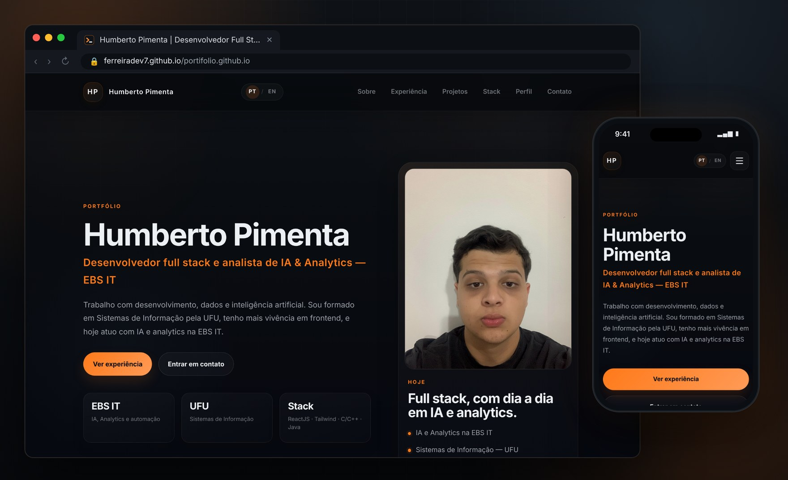
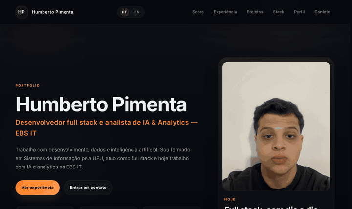
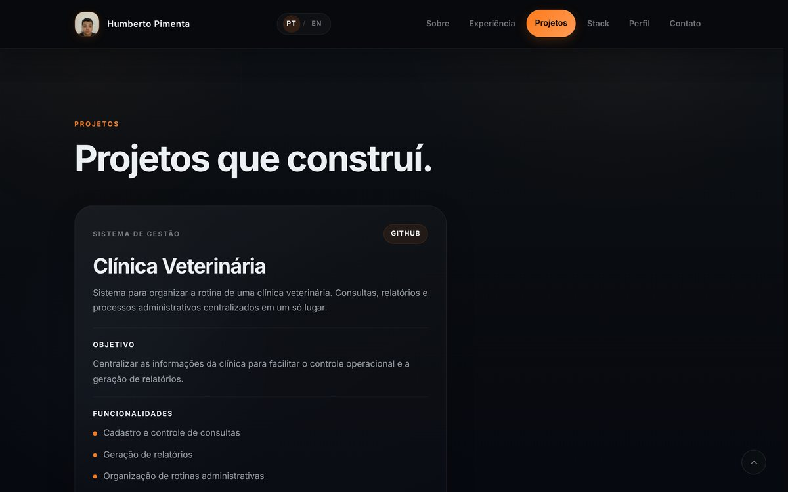
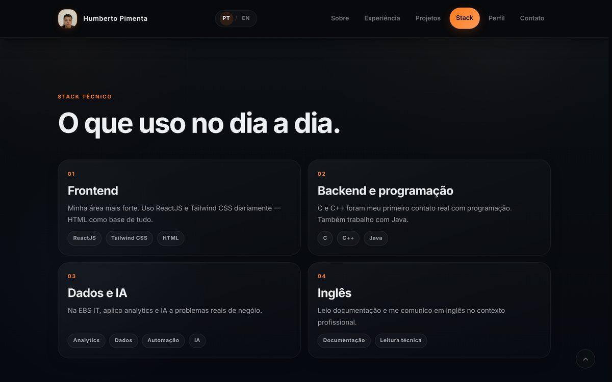
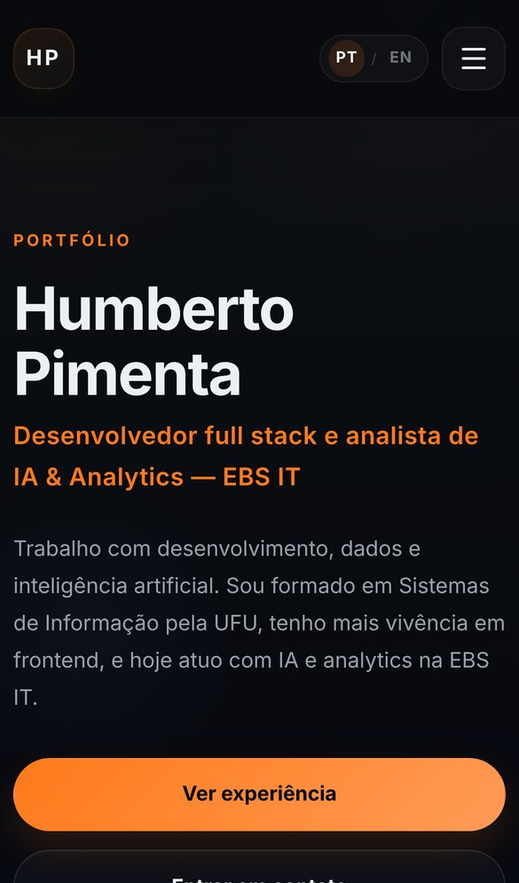
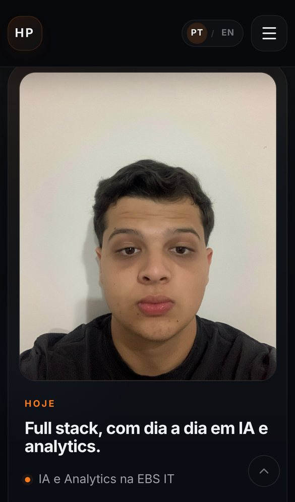
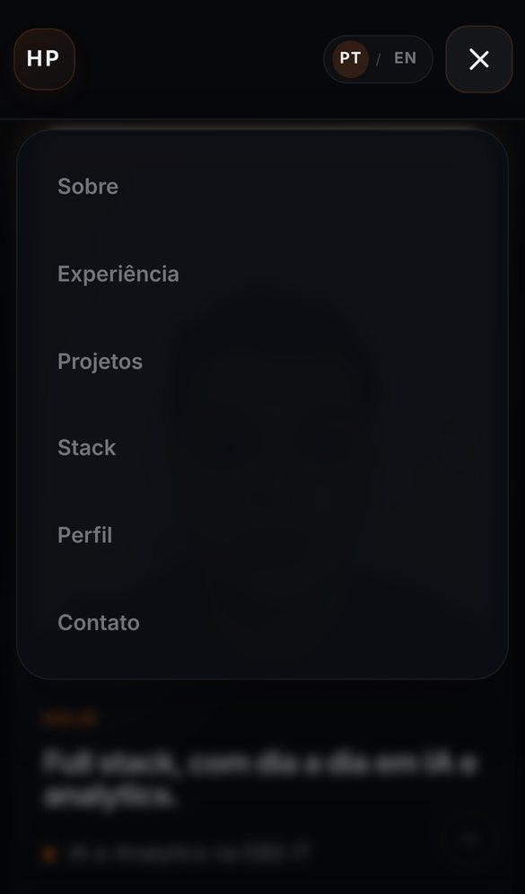

<div align="center">


# Humberto Pimenta — Portfólio

**Desenvolvedor full stack e analista de IA & Analytics na EBS IT**

[🌐 Ver o site](https://ferreiradev7.github.io/portifolio.github.io/) ·
[LinkedIn](https://www.linkedin.com/in/humberto-pimenta) ·
[E-mail](mailto:humbertopferreiraf@gmail.com)

<br>


<br>

<a href="https://ferreiradev7.github.io/portifolio.github.io/">
  
</a>

</div>

---

## ✨ Em movimento

<div align="center">
  
  <sub>Ao rolar, a foto do hero encolhe e vira o avatar do header.</sub>
</div>

## 🖥️ Seções

<table>
  <tr>
    <td width="50%"><p align="center"><b>Experiência</b></p></td>
    <td width="50%"><p align="center"><b>Projetos</b></p></td>
  </tr>
  <tr>
    <td width="50%"><p align="center"><b>Stack</b></p></td>
    <td width="50%"><p align="center"><b>Contato</b></p></td>
  </tr>
</table>

## 📱 No celular

<div align="center">
  &nbsp;
  &nbsp;
  
</div>

## ⚙️ Por dentro

- **HTML, CSS e JavaScript puros** — sem framework, sem build e sem dependências.
- **Bilíngue (PT/EN)** — troca instantânea de idioma, com a escolha salva no navegador.
- **Animações de entrada** com `IntersectionObserver`, desligadas para quem usa `prefers-reduced-motion`.
- **Foto que vira avatar** — no desktop, a foto do hero se transforma no ícone do header durante a rolagem.
- **Navegação** — menu mobile com backdrop (fecha com `Esc` ou clique fora) e destaque da seção ativa no menu.
- **Acessibilidade** — skip link, foco visível, `aria-expanded` e `aria-current`.
- **Responsivo** — breakpoints em 1200, 1080, 860, 720 e 640 px.

## 📁 Estrutura

```text
.
├── index.html            # página única com todas as seções
├── style.css             # tokens de cor, layout e responsividade
├── script.js             # interações, animações e traduções PT/EN
├── imagens/
│   ├── fotoportifolio.jpg
│   └── icons/            # favicon de terminal (SVG, ICO e PNG)
└── .github/readme/       # imagens usadas neste README
```

## 🚀 Rodando localmente

Não precisa instalar nada. Clone o repositório e sirva a pasta:

```bash
git clone https://github.com/ferreiradev7/portifolio.github.io.git
```

```bash
cd portifolio.github.io && python3 -m http.server 8000
```

Depois é só abrir `http://localhost:8000` (ou abrir o `index.html` direto no navegador).

## 📬 Contato

- **LinkedIn:** [linkedin.com/in/humberto-pimenta](https://www.linkedin.com/in/humberto-pimenta)
- **E-mail:** [humbertopferreiraf@gmail.com](mailto:humbertopferreiraf@gmail.com)
- **GitHub:** [@ferreiradev7](https://github.com/ferreiradev7)

<div align="center">
  <br>
  <sub>Feito por Humberto Pimenta</sub>
</div>
